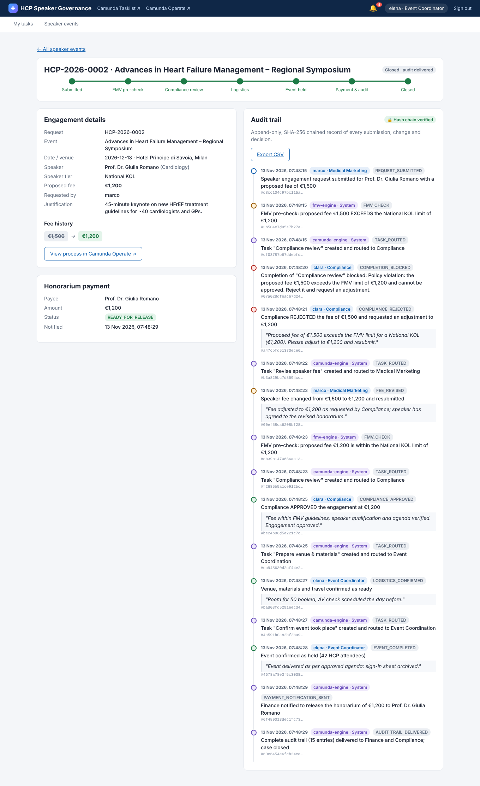

# HCP Speaker Event Governance: Camunda process orchestration demo

PoC that shows how **Camunda BPM** can orchestrate a regulated pharma process: governing a
Healthcare Professional (HCP) speaker engagement, from request to payment, with Compliance
gatekeeping and an inspection-ready audit trail.

```
docker compose up -d --build
```

Wait about 1–2 minutes, then open **http://localhost:3000**.



---

## 1. What's inside

| Component | Technology | Role in the demo |
|---|---|---|
| **portal** | Node.js 22 + Express (vanilla JS UI) | Business UI for each role, REST API, **job workers**, audit trail. On start-up it deploys the BPMN process and forms to Camunda. |
| **camunda** | Camunda 8.10 orchestration cluster (`camunda/camunda`): Zeebe engine + Tasklist + Operate + Admin in one container | Runs the `hcp-speaker-event` process, routes user tasks, and calls the Node.js workers. |
| **postgres** | PostgreSQL 16 | Database `camunda` is Camunda's secondary storage (no Elasticsearch needed). Database `hcp` holds the portal's business data and the tamper-evident audit log. |

```
 Browser ──► Portal (Node.js :3000) ──REST v2──► Camunda 8 (:8080) ──► PostgreSQL (camunda DB)
                 │  ▲                                  │
                 │  └──── job workers (long polling) ◄─┘  fmv-check, task listeners, finance, audit
                 └──► PostgreSQL (hcp DB: speaker_event, audit_log, payments, reports)
```

### The process (`process/hcp-speaker-event.bpmn`)

```
(Request submitted) → [FMV pre-check ⚙] → [Compliance review 👤] → <Approved?> ─yes→ [Prepare venue & materials 👤]
                             ▲                                        │no                       ↓
                             └────────── [Revise speaker fee 👤] ◄────┘            [Confirm event took place 👤]
                                                                                              ↓
                       (Closed, inspection-ready) ← [Deliver audit trail ⚙] ← [Notify Finance: release honorarium ⚙]
```

* ⚙ **Service tasks** are executed by the Node.js workers (`portal/src/workers.js`).
* 👤 **User tasks** are routed to the candidate groups `compliance`, `medical-marketing` and `event-coordination`.
* Every user task has **task listeners** (`creating` and `completing`) handled by the Node.js worker. Because they run
  inside the engine's lifecycle, every human decision is validated and written to the audit trail, **whether the task
  is completed in the portal or in Camunda Tasklist**. A listener can also **deny** a completion, which is how
  the demo enforces:
  * **The FMV policy**: Compliance cannot approve a fee above the Fair Market Value limit of the speaker's tier.
  * **Segregation of duties**: only the right role can complete each task (Marketing cannot approve its own request).
  * **Mandatory justification**: no decision without a comment, and no change without a change note.

### Fair Market Value limits (per engagement)

| Speaker tier | FMV limit |
|---|---|
| Local HCP | €600 |
| Regional KOL | €900 |
| **National KOL** (used in the demo) | **€1,200** |
| International KOL | €2,500 |

### Audit trail: how it is made tamper-evident

* Table `audit_log` is **append-only**: a PostgreSQL trigger rejects every `UPDATE`/`DELETE`.
* Every entry stores the **SHA-256 hash** of its content plus the previous entry's hash (a hash chain per request).
  The portal re-verifies the chain on every view ("🔒 Hash chain verified").
* At close-out the process freezes a **JSON audit report** (with the chain verification result) and delivers it to
  Finance and Compliance.

---

## 2. Start the demo

**Prerequisites:** Docker with the Compose plugin, about 3 GB of free RAM, and free ports `3000`, `8080`, `5432`, `26500`.

```bash
docker compose up -d --build      # first start downloads the images (~1.5 GB)
docker compose ps                 # wait until camunda is "healthy" and portal is "running"
docker compose logs -f portal     # you should see "[boot] HCP portal ready on http://localhost:3000"
```

Reset everything to a clean state (deletes all process instances and data):

```bash
docker compose down -v && docker compose up -d --build
```

---

## 3. URLs and logins

| UI | URL | What it is for |
|---|---|---|
| **HCP Portal** (main demo UI) | http://localhost:3000 | Role-based business UI: submit requests, task inbox, audit trail, payments |
| **Camunda Tasklist** | http://localhost:8080/tasklist | Camunda's standard task UI (the same tasks, rendered with Camunda Forms) |
| **Camunda Operate** | http://localhost:8080/operate | Technical monitoring: live BPMN diagram of each instance, variables, incidents |
| **Camunda Admin** | http://localhost:8080/admin | Users, groups, roles |
| PostgreSQL | `localhost:5432` | `postgres`/`postgres` (superuser), `hcp`/`hcp` (portal DB), `camunda`/`camunda` (Camunda DB) |

All users are **Camunda users** (defined in `camunda/application.yaml`). The portal checks every login against
Camunda, so the same credentials work in the portal and in the Camunda web apps.

| Persona | Username | Password | Role in the story |
|---|---|---|---|
| Marco Rossi | `marco` | `marco` | Brand Manager, **Medical Marketing**: submits requests and revises the fee |
| Clara Bianchi | `clara` | `clara` | **Compliance Officer**: reviews, rejects or approves |
| Elena Verdi | `elena` | `elena` | **Event Coordinator**: logistics and event close-out |
| Fabio Neri | `fabio` | `fabio` | **Finance**: receives the payment notification and the audit report |
| Demo admin | `demo` | `demo` | Sees everything (use it for Operate and Admin) |

> Tip: open each persona in a separate browser profile or private window, so you can switch roles without logging out.
> On the portal login page you can also just click a persona card.

---

## 4. Demo script (about 10 minutes)

### Step 1: Initiation (Medical Marketing): user story 1
1. Open http://localhost:3000 and log in as **`marco` / `marco`**.
2. Click **+ New request**. The form is pre-filled with the scenario: *Prof. Dr. Giulia Romano, Cardiology,
   **National KOL**, fee **€1,500***.
3. Click **Submit for approval**.
4. You land on the request page. Point out:
   * the progress stepper: *Submitted → FMV pre-check → **Compliance review***;
   * the audit trail: `REQUEST_SUBMITTED` by marco, then the automatic `FMV_CHECK` (*€1,500 EXCEEDS the
     National KOL limit of €1,200*), then `TASK_ROUTED` to Compliance. Nobody sent an email.

### Step 2: Compliance review and deviation (Compliance): user story 2
1. Log in as **`clara` / `clara`**. **My tasks** shows *Compliance review · HCP-2026-0001* with an
   **FMV exceeded** badge. The 🔔 bell shows the notification.
2. Open the task. The left side shows the request and the FMV result; the right side shows the full history.
3. *Optional "policy enforcement" moment:* select **Approve engagement** and submit.
   The engine **blocks** it (*"Policy violation: the proposed fee €1,500 exceeds the FMV limit…"*), and the blocked
   attempt itself is recorded in the audit trail (`COMPLETION_BLOCKED`).
4. Select **Reject fee: return to Marketing**. The recommended fee is €1,200 and the comment is pre-filled:
   *"…Please adjust the fee to €1,200 and resubmit."* Click **Submit decision**.
5. The request is now *Returned for fee change* and routed back to Medical Marketing.

### Step 3: Correction and approval (Marketing, then Compliance)
1. As **`marco`**: **My tasks** → *Revise speaker fee*. The Compliance comment and the recommended €1,200 are shown.
   Click **Resubmit to Compliance**. The FMV pre-check runs again automatically (*within limit*).
2. As **`clara`**: open the new *Compliance review*. The **Fee history** shows `€1,500 → €1,200`
   (hover to see who changed it and when), and the timeline shows who requested the change and when it was made.
   Keep **Approve engagement** and click **Submit decision**.

### Step 4: Logistics readiness (Event Coordinator): user story 3
1. Log in as **`elena` / `elena`**. The *Prepare venue & materials* task appears **only now**, after the approval:
   the coordinator never sees uncleared events.
2. Click **✔ Confirm everything is ready**: one click.

### Step 5: Close-out and audit record (Coordinator, then Finance and Compliance): user stories 4 and 5
1. Still as **`elena`**: open *Confirm event took place* and click **✔ Confirm event completed**.
2. The process then runs automatically:
   * **Notify Finance**: a payment notification (*release €1,200 to Prof. Dr. Giulia Romano*) is created;
   * **Deliver audit trail**: the complete, hash-chain-verified report is delivered to Finance and Compliance;
     the case is **Closed · audit delivered**.
3. Log in as **`fabio` / `fabio`**: **Payments & audit reports** shows the honorarium *READY_FOR_RELEASE* and the
   delivered report (🔒 chain valid). Click **Download** to get the JSON report.
4. As **`clara`**, open the request: the full timestamped timeline of every submission, fee change, decision,
   blocked attempt and system step. **Export CSV** for transparency reporting.

### Step 6: Show the engine (optional, technical audience)
* **Camunda Operate** (http://localhost:8080/operate, `demo`/`demo`): open *HCP Speaker Event Governance* and pick
  an instance (or use **View process in Camunda Operate** on a request page). You see the BPMN path actually taken,
  including the rejection loop, plus all process variables.
* **Camunda Tasklist** (http://localhost:8080/tasklist): submit a new request in the portal, then log in to Tasklist
  as `clara`, open *Compliance review*, click **Assign to me**, fill in the Camunda Form and click **Complete Task**.
  The decision shows up in the portal audit trail too, because the task listeners capture it at engine level.
  Policy and segregation-of-duties rules apply in Tasklist as well.
* **Tamper evidence**: try to change history directly in the database:
  ```bash
  docker compose exec postgres psql -U hcp -d hcp -c "UPDATE audit_log SET summary='edited' WHERE id=1;"
  # ERROR:  audit_log is append-only: UPDATE is not allowed
  ```

---

## 5. Repository layout

```
docker-compose.yml           # postgres + camunda + portal
camunda/application.yaml     # Camunda config: PostgreSQL secondary storage, basic auth, demo users
postgres/init.sql            # creates the "camunda" and "hcp" databases/users
process/
  hcp-speaker-event.bpmn     # the process model (open it with Camunda Modeler)
  forms/*.form               # Camunda Forms used by Camunda Tasklist
portal/
  src/server.js              # REST API, sessions, bootstrap (deploys process + forms, creates groups)
  src/workers.js             # job workers: FMV check, task listeners (audit + rules), finance, audit report
  src/camunda.js             # small Camunda 8 REST v2 client (no SDK needed)
  src/db.js                  # schema, append-only hash-chained audit log
  public/                    # single-page UI (no build step)
```

To change the process, edit `process/hcp-speaker-event.bpmn` in Camunda Modeler (Camunda 8 / Self-Managed, REST
endpoint `http://localhost:8080`, basic auth `demo`/`demo`), or simply run `docker compose restart portal`: the
portal redeploys everything in `process/` on start-up.

---

## 6. Notes and troubleshooting

* **Why Camunda 8 and not Camunda 7?** The Camunda 7 Community Edition reached end of life, and its
  `camunda/camunda-bpm-platform` images are no longer available on Docker Hub. This demo uses the current
  Camunda 8 single-image distribution, which can run on **PostgreSQL** alone. That keeps the stack at
  three containers with no Elasticsearch. Camunda 8 Self-Managed is free for non-production use; the web apps show a
  *"Non-production license"* badge.
* **Portal shows "Session expired" / logs you out:** portal sessions are kept in memory, so restarting the `portal`
  container logs everyone out. Log in again.
* **Tasks don't appear immediately:** Camunda exports to PostgreSQL asynchronously; the task inbox refreshes every 5
  seconds.
* **Camunda takes long to start / is killed:** give Docker at least 3 GB RAM. The JVM heap is capped at 1 GB in
  `docker-compose.yml`.
* **Port already in use:** change the left-hand side of the `ports:` mappings in `docker-compose.yml` (if you change
  8080, also update `CAMUNDA_PUBLIC_URL` of the portal).
* **Automated check:** `./scripts/smoke-test.sh` runs the whole storyline through the portal API and prints the
  resulting audit trail (best on a freshly reset stack).
* **Logs:** `docker compose logs -f portal` shows every worker/listener execution;
  `docker compose logs -f camunda` shows the engine.

> Demo only: credentials are hard-coded, sessions are in memory and authorizations are disabled in Camunda. Don't use
> this configuration in production.
